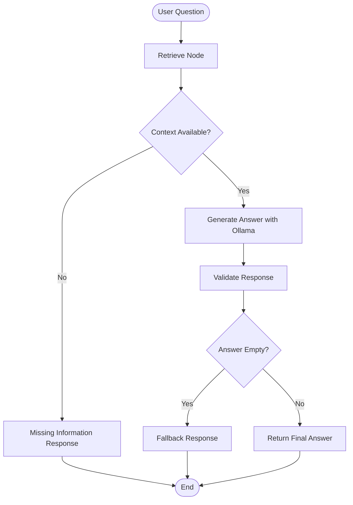

# Capstone AI Agent Architecture

## Components

- **RAG:** FAISS retrieves relevant PDF chunks.
- **Tool:** `search_knowledge_base` searches the local knowledge base.
- **LLM:** Ollama runs the local Llama 3.2 model.
- **Workflow:** LangGraph controls retrieval, generation, validation and routing.
- **Observability:** LangSmith records traced execution for inspection.
